<picture>
  <source media="(max-width: 600px)" srcset="./assets/header-mobile.png" />
  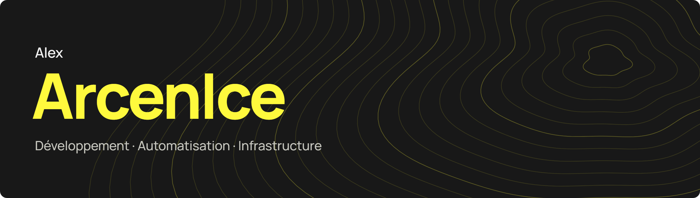
</picture>

 

**DevOps chez Atmo Hauts-de-France. Directeur général et cofondateur de Seapalm.**

Je développe aussi **Nodulz**, entre automatisation, intégrations et agents IA.

## Projets

  
  <strong>Nodulz</strong> 
  Workflows, intégrations et agents IA. 
  <a href="https://nodulz.com/fr">nodulz.com</a>

 

  
  <strong>Seapalm</strong> 
  Création de sites et d'applications web. 
  <a href="https://seapalm.fr/">seapalm.fr</a>

 

  
Parcours & expériences

### Seapalm

- **Directeur général** · février 2026 — aujourd'hui.
- **Cofondateur** · août 2023 — aujourd'hui.

### Atmo Hauts-de-France

- **Ingénieur DevOps, CDI** · septembre 2025 — aujourd'hui.
- **Ingénieur DevOps, CDD** · septembre 2024 — septembre 2025.
- **Technicien de maintenance de systèmes informatiques, alternance** · septembre 2022 — septembre 2024.

### Expériences passées dans le jeu vidéo

- **GoldenGames · Développeur en chef** · novembre 2023 — mars 2025.
- **Pirates Destiny · Développeur en chef** · janvier 2021 — novembre 2023.

## Compétences

#### Cloud & infrastructure

  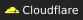
  
  
  
  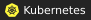
  
  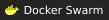
  

#### DevOps & livraison

  
  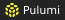
  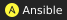
  
  
  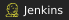
  
  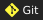
  
  

#### Observabilité & secrets

  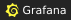
  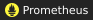
  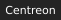
  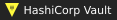

#### Web & applications

  
  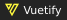
  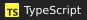
  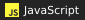
  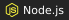
  
  
  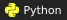
  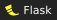
  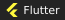
  
  
  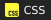
  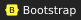

#### Données & automatisation

  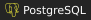
  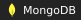
  
  
  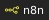

#### Design & collaboration

  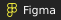
  
  
  
  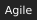
  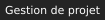
  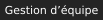
  
  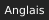

#### Jeux

  
  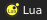

**Développement** · Front-end, full-stack, applications web, logiciels et API REST. 
**Conception** · Interfaces web et conception front-end. 
**Équipe & produit** · Gestion de projet agile, gestion d'équipe et création de start-up. 
**Jeux** · Développement et programmation de jeux vidéo. 
**Support** · Maintenance de systèmes informatiques et support technique.

## Activité GitHub

  
Statistiques détaillées

   
  

